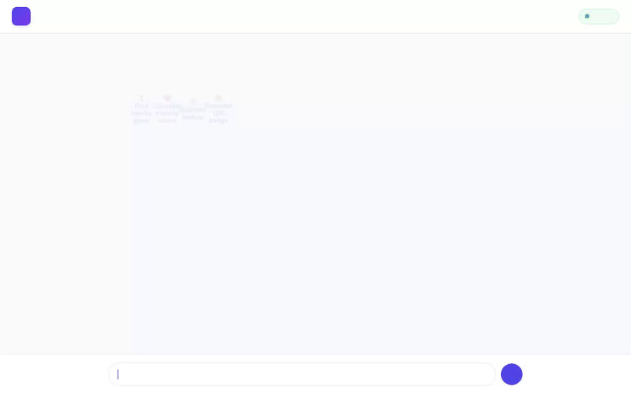

# PulseCoach AI ⚡🏋️

An intelligent, multi-modal personal fitness & wellness AI coach built with Google's Agent Development Kit (ADK), Vertex AI, and Google Cloud services. PulseCoach AI provides personalized training plans, nutrition lookups, heart rate zone calculations, nearby gym discovery, Firestore workout logging, long-term memory across sessions, and custom AI-generated achievement badges.



---

## 🌟 What PulseCoach AI Does

PulseCoach AI operates as an agentic fitness companion that remembers your preferences, allergies, and health goals over time while assisting you with daily wellness and training tasks:

* **Long-Term Memory across Sessions**: Remembers user health conditions, food/drug allergies, fitness goals, and preferences across sessions using Vertex AI Memory Bank.
* **Rich Display UI (A2UI)**: Renders structured, compact UI surfaces (cards, column layouts, text, and images) using A2UI schema version 0.8 and `A2uiSchemaManager`.
* **Personalized Heart Rate & Metabolic Targets**: Calculates Karvonen Heart Rate Training Zones (Warmup, Fat Burn, Aerobic, Anaerobic, Peak), Basal Metabolic Rate (BMR via Mifflin-St Jeor), and Total Daily Energy Expenditure (TDEE).
* **Firestore Workout Catalog & Session Logging**: Searches an exercise catalog stored in Google Cloud Firestore and logs workout sessions (exercise name, duration, calories burned, timestamp, notes) directly to Firestore.
* **AI Workout Badge Generation & Cloud Storage**: Generates vibrant, high-quality fitness achievement badges using `gemini-3.1-flash-lite-image` in the global region and uploads them to Google Cloud Storage for public HTTPS rendering.
* **Location & Gym Discovery**: Geocodes addresses via Google Maps Geocoding API and searches nearby gyms or sports facilities via Google Places API (`searchNearby`).
* **Live External Fitness & Nutrition APIs**: Fetches real-world exercise definitions from the wger Workout Manager API and retrieves nutritional breakdowns (calories, protein, carbs, fat per 100g) from the Open Food Facts API.
* **Sandboxed Code Execution**: Executes custom data analysis and workout metrics calculations securely via `AgentEngineSandboxCodeExecutor`.

---

## ☁️ Implemented Google Cloud Services & Tools

* **Vertex AI Memory Bank**: Integrated via `VertexAiMemoryBankService` and `PreloadMemoryTool`.
* **Google Cloud Firestore**: Interacted with via `google.cloud.firestore.Client` for catalog queries and workout logs.
* **Vertex AI Image Generation**: Powered by model `gemini-3.1-flash-lite-image` (global region).
* **Google Cloud Storage (GCS)**: Stores generated badge assets for public HTTPS serving.
* **Google Maps & Places APIs**: Used for geocoding and `searchNearby` facility lookup.
* **A2UI Protocol (v0.8)**: Generates structured UI schemas converted via `a2ui_utils.py` model callbacks.
* **Agent Engine Sandbox**: Runs sandboxed Python code routines on Agent Platform.

---

## 📋 Planned / Not Yet Implemented Features

The following features were discussed or explored but are not currently implemented in the core codebase:
* *Wearable Device Sync (Apple Health / Google Fit Direct API Sync)* — Planned, not yet implemented.
* *Real-Time Voice Coaching & Audio Streaming* — Planned, not yet implemented.

---

## 🛠️ Local Development & Setup Instructions

### Prerequisites

* Python 3.11+
* `uv` package manager (`pip install uv`)
* Google Cloud project with Vertex AI, Firestore, and Cloud Storage enabled
* `GOOGLE_MAPS_API_KEY` set in environment or `.env`

### Installation

1. **Clone the repository and install dependencies**:
   ```bash
   git clone <your-repo-url>
   cd pulsecoach-ai
   uv sync
   ```

2. **Configure Environment Variables**:
   Create a `.env` file in the project root:
   ```env
   GOOGLE_GENAI_USE_VERTEXAI=true
   GOOGLE_CLOUD_PROJECT=your-gcp-project-id
   GOOGLE_CLOUD_LOCATION=us-east1
   GOOGLE_MAPS_API_KEY=your-google-maps-api-key
   ```

3. **Run the Local Agent Playground**:
   Start the local ADK Web playground:
   ```bash
   uv run adk web . --port 8080 --allow_origins "*" --reload_agents
   ```

4. **Run the FastAPI Custom Web Frontend**:
   Navigate to the `frontend/` directory and start the proxy server:
   ```bash
   cd frontend
   pip install -r requirements.txt
   export AGENT_ENGINE_RESOURCE_NAME="projects/your-project/locations/us-east1/reasoningEngines/your-engine-id"
   export AGENT_DIRECTORY="app"
   python main.py
   ```

---

## 🚀 Deployment

Deploy the agent to Agent Platform (Agent Runtime) using `agents-cli`:

```bash
agents-cli deploy --update-env-vars GOOGLE_MAPS_API_KEY=your-api-key --no-confirm-project
```

---

## 📄 License

Apache License 2.0.
